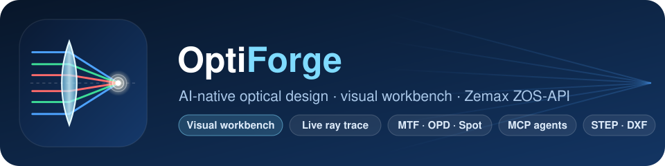
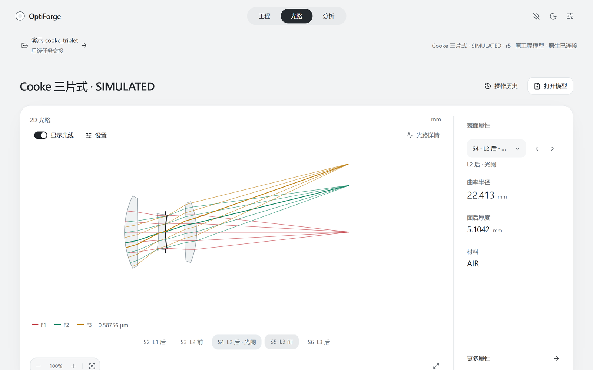
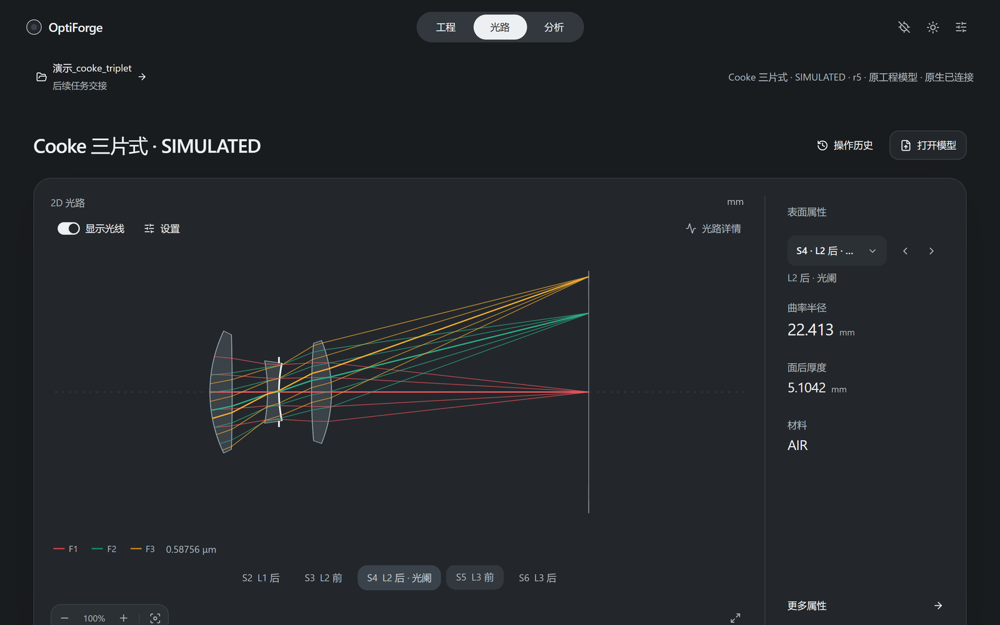
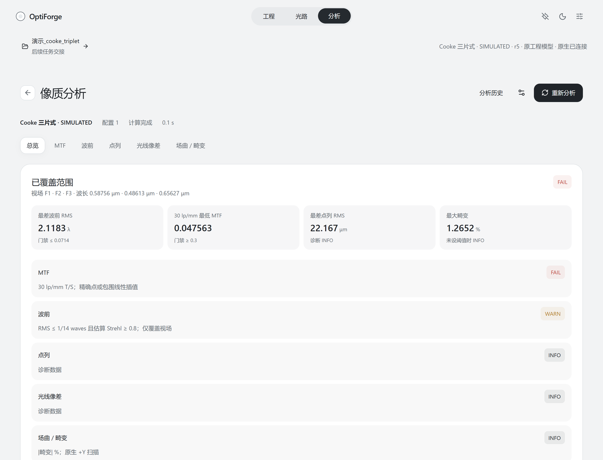
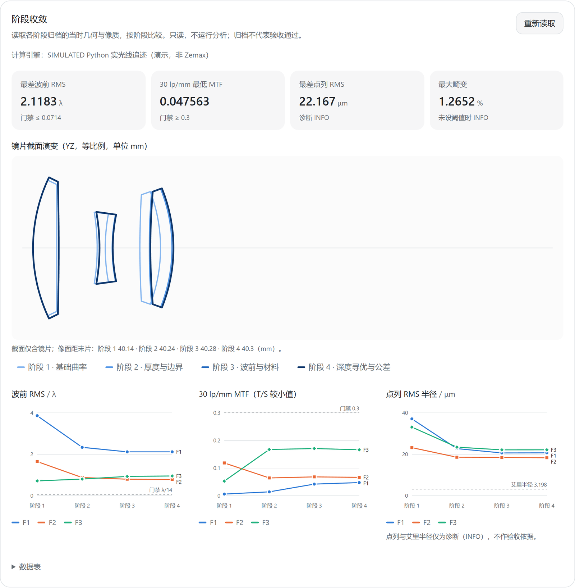
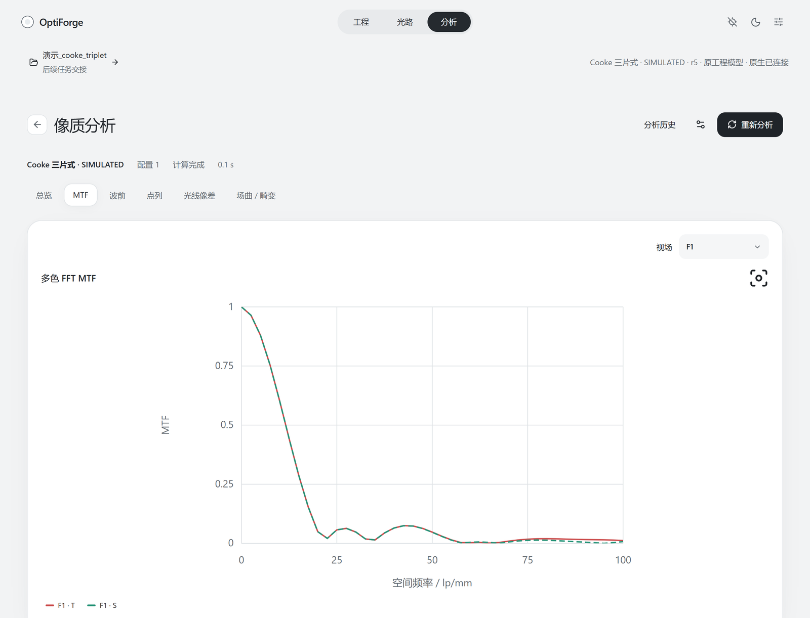
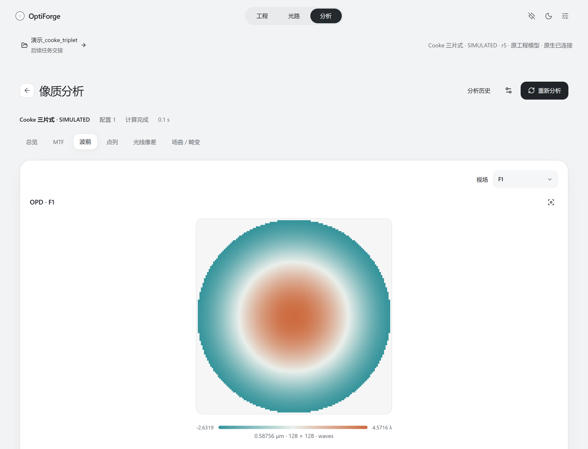
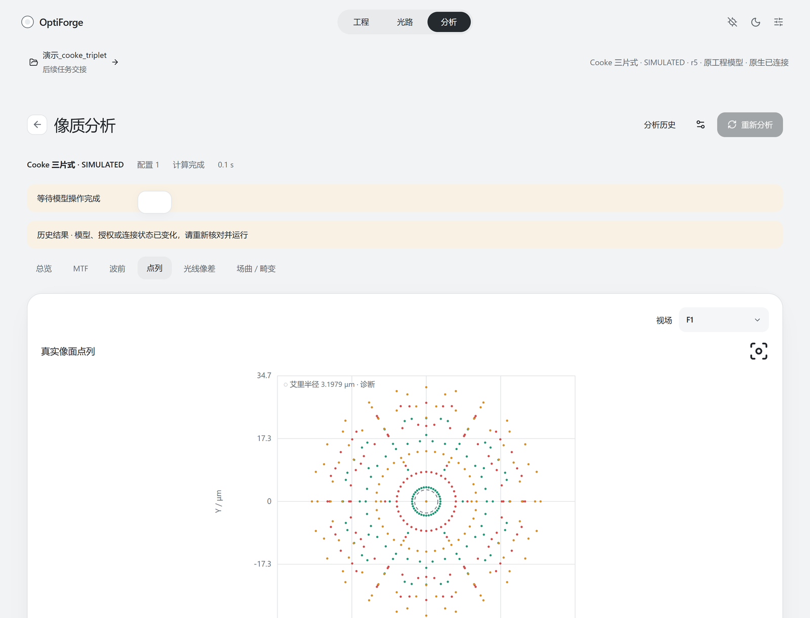
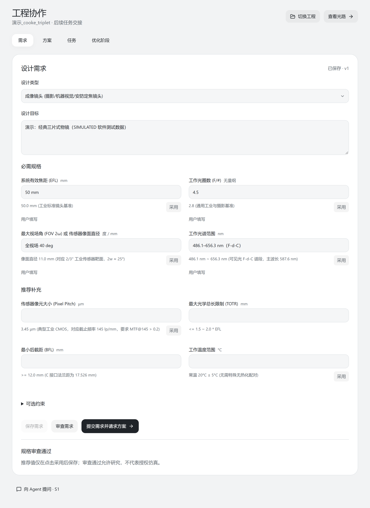

<div align="center">



**AI-native optical design over Zemax OpticStudio, with a visual workbench you and your agent share.**

[](https://www.python.org/)
[](frontend/)
[](https://www.ansys.com/products/optics/ansys-zemax-opticstudio)
[](https://modelcontextprotocol.io/)
[](#quickstart)
[](LICENSE)

**English** · [简体中文](README.zh-CN.md)

<a href="assets/workbench/workbench-tour.mp4"></a>

<sub>A 38-second tour of the workbench. Click for the MP4. The tour runs the bundled demo, where the optics are <b>simulated</b> and Zemax is never opened.</sub>

</div>

---

## What it is

OptiForge lets an AI agent (Claude, Codex, Gemini, Cursor or any other MCP client) design real lenses in **Ansys Zemax OpticStudio**, and lets you watch and steer the work in a **local visual workbench**.

- **The agent talks.** It works through 69 MCP tools: spec audit, proposal, modeling, optimization, analysis, CAD.
- **The workbench shows.** It displays the same live model: layout, real rays, image quality, stage history.
- **The gates hold.** Nothing is simulated until you approve a proposal, and manufacturing rules are checked before anything is written.

## ✨ Visual workbench

The workbench is a local web app (`python -B workbench.py`). The agent and the UI drive **one engine**, so they always show the same model, the same proposal and the same gate state.

<table>
<tr>
<td width="50%"></td>
<td width="50%"></td>
</tr>
<tr>
<td><b>Live layout and real rays.</b> The 2D section is drawn at true scale from the live model. Rays come from Zemax's own real-ray trace. You pick fields, wavelengths and pupil sampling, and can zoom, pan and inspect any surface.</td>
<td><b>Light and dark themes.</b> Every chart palette is checked on both surfaces. Theme, legend and zoom only change the display; they never touch the model.</td>
</tr>
<tr>
<td></td>
<td></td>
</tr>
<tr>
<td><b>Image-quality suite.</b> One click runs FFT MTF, an OPD wavefront map, a native spot diagram, ray aberrations, and field curvature with distortion. Wavefront RMS, Strehl and MTF are <i>gates</i>; spot size against the Airy disk is <i>diagnostic only</i>.</td>
<td><b>Stage convergence.</b> Each of the four optimization stages is archived with its geometry and image quality. The lens sections are overlaid and wavefront, MTF and spot are charted stage by stage against the gate lines.</td>
</tr>
</table>

More of what the workbench does:

- **Requirements → proposal → tasks.** You fill in specs in the UI, run the completeness audit, and hand a task to the agent. You review its structured proposal and confirm it, all in one place.
- **Follow Agent.** While the agent works, the workbench jumps to the page it just changed. One click turns this off.
- **Inside the chat.** In hosts that support MCP Apps (Claude, VS Code), `optiforge_workbench_view` shows the layout, stages or analysis as an interactive panel inside the conversation. Other hosts get an image.
- **Optional desktop window.** `start-workbench.ps1 -App` opens the workbench in a dedicated Edge or Chrome app window.

<details>
<summary><b>More screenshots</b>: MTF, wavefront map, spot diagram, requirements</summary>

| | |
| :---: | :---: |
|  |  |
|  |  |

</details>

## Engineering core

| | |
| :--- | :--- |
| 🧭 **Design SOP with a human gate** | The SOP runs in order: spec audit with recommended defaults, literature and patent search, first-order and Seidel reasoning, a registered proposal, then your **explicit approval** before any modeling. |
| 🏭 **Manufacturing rules as gates** | The rules cover CT and ET (edge thickness at clear aperture + 1 mm), air-gap caps, Karow centering, test-plate steepness, hemisphere and near-flat bans, and AOI limits. A prescription is pre-checked and rejected **before** it is written. |
| ⚙️ **Robust optimization** | DLS and Hammer run with boundary operands already in place. A pre-flight ray-feasibility check runs first. A stagnation guard stops the run early. Native waits are bounded and cancelled rounds are undone. |
| 📐 **Deliverables** | STEP, IGES and STL export; editable DXF part and assembly drawings (GB/T 13323 / ISO 10110); a JSON bridge for SolidWorks MCP; tolerance analysis. |
| 🗂️ **Project workspaces** | Each design gets its own folder: `output/<project>/{cad,drawings,optomech,reports}`. |

<a name="quickstart"></a>
## Quickstart

**Requirements:** Windows 10/11 x64, Python 3.10+, Node.js 20.19+ (or 22.12+), and Ansys Zemax OpticStudio 2021+ with a license that allows ZOS-API (Premium, Professional or Enterprise).

```powershell
git clone https://github.com/zhaopeizhao41-ops/optiforge.git
cd optiforge
pip install -r requirements.txt
cd frontend; npm ci; cd ..
```

### 1. Start the workbench

```powershell
.\start-workbench.ps1              # builds the frontend, then serves http://127.0.0.1:8765/
.\start-workbench.ps1 -App         # same, in a dedicated app window
python -B workbench.py --model C:\path\to\lens.zmx   # open an existing model
```

### 2. Connect your agent

```powershell
python -B connect_agent.py --check
```

This prints a ready-to-paste MCP config for Claude Desktop, Claude Code, Cursor, VS Code, Codex or Gemini CLI. Your agent's `server.py` then forwards every call to the running workbench, so both see the same model. If you only want the agent, without the UI, point your MCP client at `server.py` directly:

```json
{ "mcpServers": { "optiforge": { "command": "python", "args": ["<PATH_TO_REPO>/server.py"] } } }
```

### Try it without Zemax

```powershell
pip install scipy
cd frontend; npm run build; cd ..
python -B tests/workbench_demo_service.py --port 8767
```

This plays a full workflow (requirements → proposal → four stages) in a temporary workspace with **simulated** optics. Open `http://127.0.0.1:8767/`. Your `output/` folder is never touched.

## Repository layout

```text
server.py      MCP entry point: tools, resources, prompts
workbench.py   Local workbench service (HTTP + engine worker)
frontend/      Workbench UI (React + Vite)
core/          ZOS-API session, workbench service, quality gates
tools/         Tool implementations: setup, surfaces, optimization, analysis, CAD
domain/        Design templates, rules, operand knowledge base, expert manual
tests/         Offline regression suite and the simulated demo service
```

Agent behaviour rules live in [`AGENTS.md`](AGENTS.md).

## License

[MIT](LICENSE)
