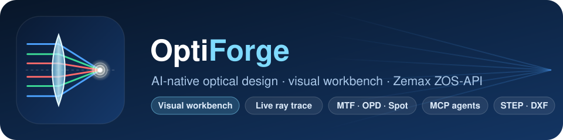
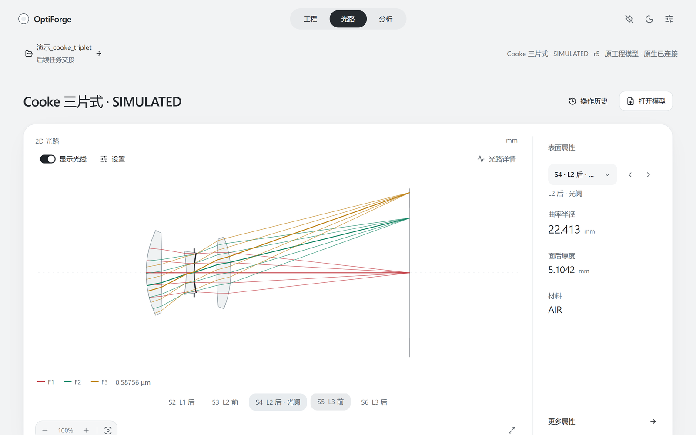
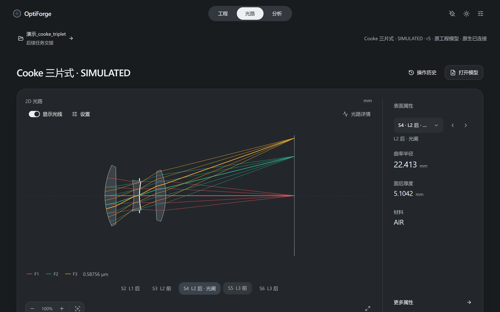
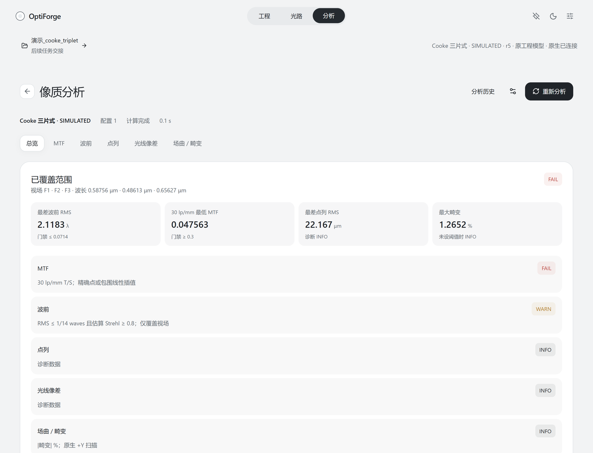
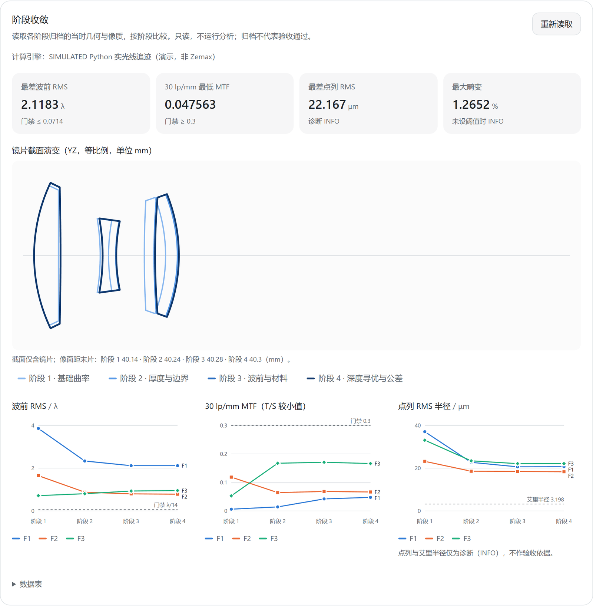
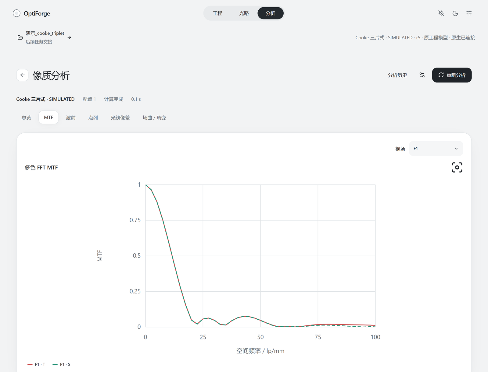
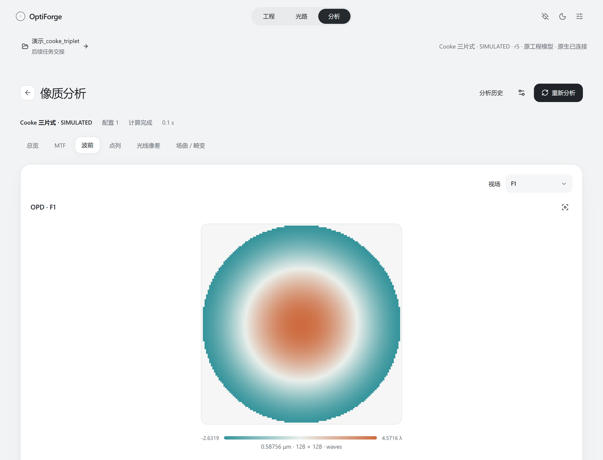
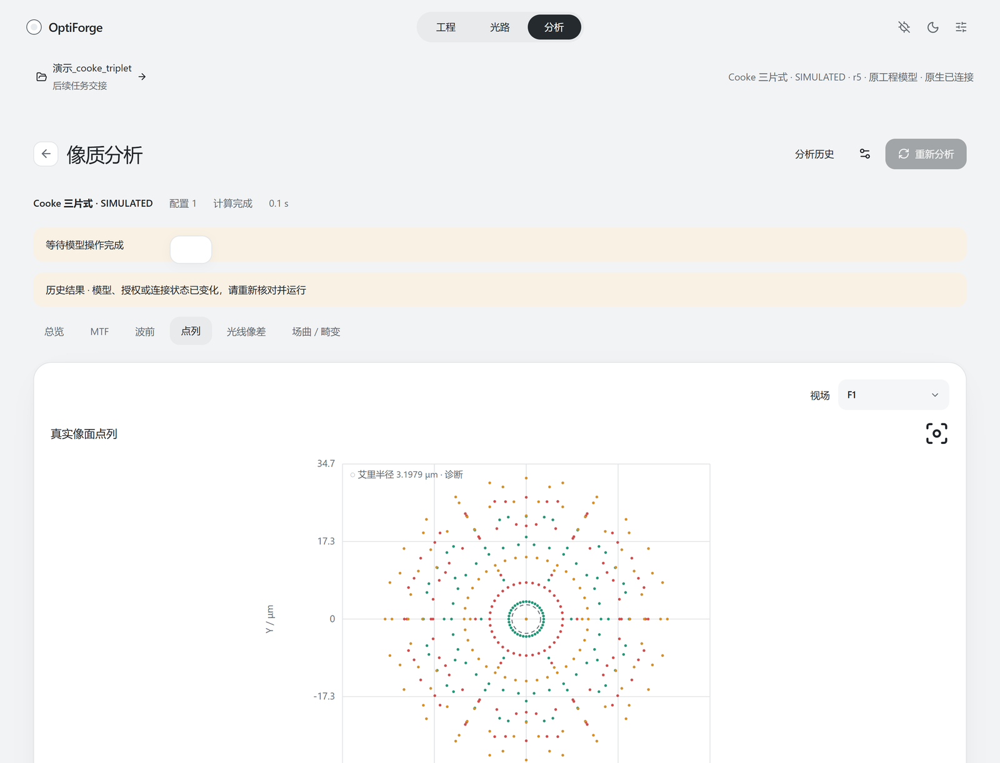
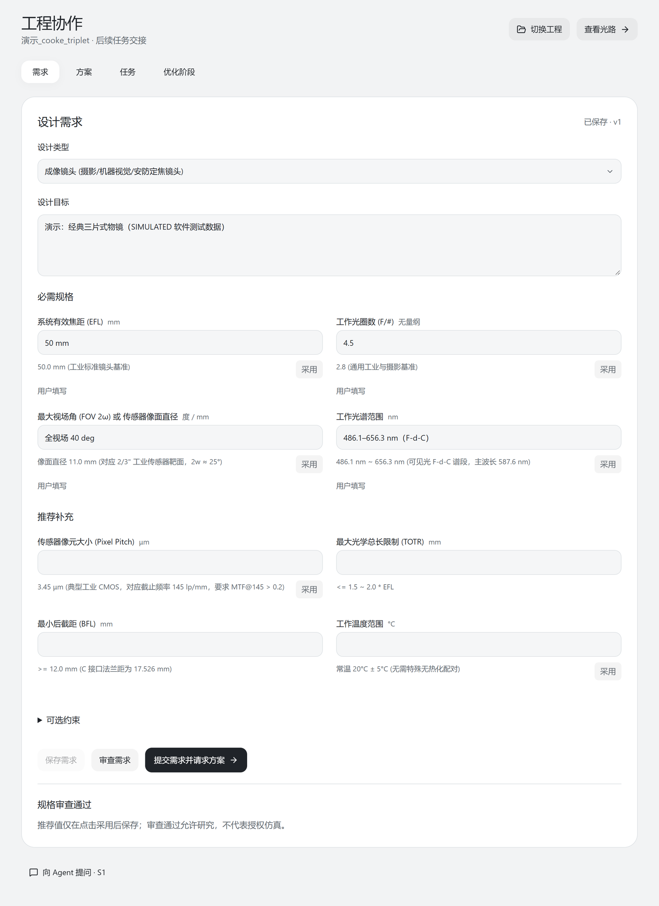

<div align="center">



**OptiForge · 光匠：基于 Zemax OpticStudio 的 AI 原生光学设计平台，配有你和 Agent 共用的可视化工作台。**

[](https://www.python.org/)
[](frontend/)
[](https://www.ansys.com/products/optics/ansys-zemax-opticstudio)
[](https://modelcontextprotocol.io/)
[](#快速开始)
[](LICENSE)

[English](README.md) · **简体中文**

<a href="assets/workbench/workbench-tour.mp4"></a>

<sub>工作台 38 秒演示，点击查看 MP4。演示使用仓库自带的演示服务，光学数据为<b>模拟</b>，不会打开 Zemax。</sub>

</div>

---

## 这是什么

OptiForge 让 AI Agent（Claude、Codex、Gemini、Cursor 或任何 MCP 客户端）在 **Ansys Zemax OpticStudio** 里设计真实镜头，并让你在**本地可视化工作台**里实时查看和把控整个过程。

- **Agent 负责对话**：通过 69 个 MCP 工具完成需求审查、方案、建模、优化、分析和 CAD 导出。
- **工作台负责呈现**：显示同一个实时模型，包括光路、实光线、像质和阶段历史。
- **门禁始终有效**：方案经你确认之前不做任何仿真；写入面型之前先检查可制造性规则。

## ✨ 可视化工作台

工作台是一个本地网页应用（`python -B workbench.py`）。Agent 和界面驱动的是**同一个引擎**，因此两边看到的模型、方案和门禁状态始终一致。

<table>
<tr>
<td width="50%"></td>
<td width="50%"></td>
</tr>
<tr>
<td><b>实时光路与实光线</b>：按真实比例绘制当前模型的二维截面，光线来自 Zemax 原生实光线追迹。可选择视场、波长和光瞳采样，支持缩放、拖动和查看任意表面。</td>
<td><b>浅色 / 深色主题</b>：所有图表配色都在两种背景下校验过。主题、图例和缩放只改变显示，不会改动模型。</td>
</tr>
<tr>
<td></td>
<td></td>
</tr>
<tr>
<td><b>像质分析套件</b>：一键运行 FFT MTF、OPD 波前图、原生点列、光线像差、场曲与畸变。波前 RMS、Strehl 和 MTF 是<i>门禁项</i>；点列与艾里斑的比较<i>仅作诊断</i>。</td>
<td><b>阶段收敛</b>：四个优化阶段各自归档几何与像质。镜片截面逐阶段叠加，波前、MTF 和点列按阶段画成曲线，并标出门禁线。</td>
</tr>
</table>

工作台的其他功能：

- **需求 → 方案 → 任务**：在界面里填写规格、运行完备性审查、把任务交给 Agent，再审阅并确认它的结构化方案，全部在一处完成。
- **跟随 Agent**：Agent 工作时，工作台自动切到它刚改动的页面，一键即可关闭。
- **在对话中查看**：支持 MCP Apps 的应用（Claude、VS Code）会把 `optiforge_workbench_view` 显示成对话内的交互面板，可查看光路、阶段或像质；其他应用会收到图片。
- **独立桌面窗口（可选）**：`start-workbench.ps1 -App` 用 Edge 或 Chrome 的独立应用窗口打开工作台。

<details>
<summary><b>更多截图</b>：MTF、波前图、点列图、需求页</summary>

| | |
| :---: | :---: |
|  |  |
|  |  |

</details>

## 工程内核

| | |
| :--- | :--- |
| 🧭 **带人工门禁的设计流程** | 依次进行：需求审查（附推荐默认值）→ 文献与专利检索 → 一阶与 Seidel 推演 → 登记方案 → **经你明确确认**后才开始建模。 |
| 🏭 **可制造性规则即门禁** | 规则包括：中心厚与边缘厚（在净口径 + 1 mm 处评估）、空气间隔上限、Karow 定心、样板陡度、禁半球与近平面、入射角上限。面型表在**写入前**整体预检，不合格即拒绝。 |
| ⚙️ **稳健的优化** | DLS 与 Hammer 运行前先布好边界操作数，并做光线可行性预检；停滞时自动提前结束。原生等待有时限，取消的回合会撤销。 |
| 📐 **交付物** | STEP / IGES / STL 导出；可编辑的 DXF 零件图与装配图（GB/T 13323 / ISO 10110）；SolidWorks MCP 的 JSON 桥接；公差分析。 |
| 🗂️ **项目工作区** | 每个设计独立一个目录：`output/<project>/{cad,drawings,optomech,reports}`。 |

## 快速开始

**环境要求**：Windows 10/11 x64、Python 3.10+、Node.js 20.19+（或 22.12+），以及 Ansys Zemax OpticStudio 2021+，许可证需支持 ZOS-API（Premium / Professional / Enterprise）。

```powershell
git clone https://github.com/zhaopeizhao41-ops/optiforge.git
cd optiforge
pip install -r requirements.txt
cd frontend; npm ci; cd ..
```

### 1. 启动工作台

```powershell
.\start-workbench.ps1              # 构建前端，然后在 http://127.0.0.1:8765/ 提供服务
.\start-workbench.ps1 -App         # 同上，在独立应用窗口中打开
python -B workbench.py --model C:\path\to\lens.zmx   # 打开已有模型
```

### 2. 连接 Agent

```powershell
python -B connect_agent.py --check
```

它会打印可直接粘贴的 MCP 配置，适用于 Claude Desktop、Claude Code、Cursor、VS Code、Codex 和 Gemini CLI。之后 Agent 启动的 `server.py` 会把所有调用转发给正在运行的工作台，两边看到的是同一个模型。如果只用 Agent、不用界面，直接让 MCP 客户端指向 `server.py` 即可：

```json
{ "mcpServers": { "optiforge": { "command": "python", "args": ["<PATH_TO_REPO>/server.py"] } } }
```

### 不装 Zemax 也能体验

```powershell
pip install scipy
cd frontend; npm run build; cd ..
python -B tests/workbench_demo_service.py --port 8767
```

它会在临时工作区里演示完整流程（需求 → 方案 → 四个阶段），光学数据为**模拟**。打开 `http://127.0.0.1:8767/` 即可查看，你的 `output/` 目录不会被改动。

## 仓库结构

```text
server.py      MCP 入口：工具、资源、提示词
workbench.py   本地工作台服务（HTTP + 引擎线程）
frontend/      工作台界面（React + Vite）
core/          ZOS-API 会话、工作台服务、质量门禁
tools/         工具实现：设置、面型、优化、分析、CAD
domain/        设计模板、规则、操作数知识库、专家手册
tests/         离线回归测试与模拟演示服务
```

Agent 行为规范见 [`AGENTS.md`](AGENTS.md)。

## 开源许可

[MIT](LICENSE)
