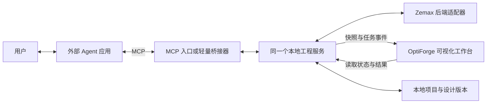

# OptiForge 本地分阶段开发与验收计划

记录日期：2026-10-27；更新日期：2026-10-28（Asia/Shanghai）。

本文记录用户已确认的产品方向和拟实施范围，不代表各阶段已经完成，也不替代仓库唯一行为规范 AGENTS.md。已完成原版本保留、开发隔离及前端体验开发。2026-10-28 用户明确回复“ui可以了”，前端体验验收通过（本地提交 `0d17b8a`）。阶段一第一批已通过 R1/R2 代码复审；第二批自动同步与断连恢复的软件实现和开发验证已完成，待最终代码复审及用户交互验收，原生写入同步仍待验证。

2026-10-27 UI 审核调整：优先完成前端体验并交用户审核，功能接入后置。主界面聚焦 2D 光路和表面属性，点列图、MTF 等分析放到二级页。双主题、柔和动效和按钮交互是本轮审核内容。具体记录见 [UI_REVIEW_V2.md](UI_REVIEW_V2.md)。

## 1. 产品交互约定

自然语言需求、规格追问、结构讨论、设计提案、仿真确认及结果解释，继续在用户选择的外部 Agent 应用中进行。OptiForge UI 是本地可视化工作台，展示项目、当前处方、光路、分析结果、任务状态、工程规则与交付物。

阶段一不要求用户在 OptiForge UI 配置 LLM API Key 或迁移对话记录。UI 不承担对话历史的同步和检索。可在后续按独立需求增加直接 LLM API 入口。

所有新版 Agent 入口与 UI 访问同一个工程服务，由该服务持有模型状态和计算任务。不能让每个 MCP 子进程各自创建一份模型，再让 UI 读取另一进程；同样不能让 UI 只展示与当前模型无关联的静态报告。

支持直接连接本地 HTTP MCP 的客户端可直连；需要 stdio 的客户端使用桥接入口。只需在选择试用新版时调整 MCP 入口配置，保持工具名称和参数兼容。具体客户端兼容性以实测结果公布，不预先承诺所有 Agent 应用都支持同一种传输。

多个 Agent 连接时共享服务的模型写入必须串行化，并明确项目归属；阶段一只有一个活动计算模型。并行独立设计会话是后续能力，不能将它误报为已有功能。

## 2. 原版本与本地开发隔离

- 稳定源码提交：`69bdb51f225a19ffddff4d18221d4b2495f814f2`。
- 原工作区：`D:\mcp gemini zemax`，继续保留在 `main`。
- 本地基线标签：`baseline/pre-visual-workbench-2026-10-27`，指向上述稳定提交。
- 新版分支：`codex/visual-workbench-stage-one`。
- 新版工作区：`C:\Users\Kernel\.codex\worktrees\optiforge-visual-workbench\mcp gemini zemax`。
- 远程地址已核对为 `git@github.com:zhaopeizhao41-ops/optiforge.git`（SSH）。
- 新版本、标签及文档先只在本地保存；本次不执行 push、发布、远程 PR 或云端部署。将来上传须遵循用户另行给出的上传指令，并使用 SSH。

源码标签保留受 Git 跟踪的版本。原工作区中被忽略的设计输出和本机客户端配置仍保留原处，未自动复制到新工作区。新版使用独立输出目录，引用旧项目须明确为只读读取或显式复制后使用。

## 3. 阶段一：外部 Agent 驱动的本地可视化工作台

### UI 通过后的接入顺序与分批验收

1. **真实模型只读显示**：建立同一个本地工程服务供 MCP 与 UI 使用，先读取已有模型的表面、材料、单位、光阑、视场和波长。首页以真实处方生成所支持面型的二维轮廓，曲面选择与属性对应；尚未取得真实追迹数据时不得展示样例光线冒充追迹。不支持的面型应明确提示。此批验收核对 UI 与已有模型的参数、曲面索引及轮廓一致性，刷新后仍一致。
2. **Agent 操作实时同步**：接入工具操作事件、模型修订号与刷新恢复。对话保留在外部 Agent；在另行确认的验收项目上修改参数后，UI 自动更新。沿用现有提案门禁与操作串行化，此批验收包括门禁无法绕过、参数修改同步及断连恢复。
3. **真实光线与分析**：接入获准验收项目的真实追迹、点列图、MTF、波前与任务状态，结果关联项目、模型修订与计算设置。模型变动后旧结果标为过期。此批验收比较源结果与 UI 的数据和设置一致性，不以样例曲线验收。
4. **本地试用交付**：提供启动与停止入口、实际验证过的 Agent 连接配置、错误反馈、回退说明和整体验收记录。保持稳定原版可用，按用户要求继续本地保存，不上传云端。

每批完成先交用户验收，确认后进入下一批。上述为软件功能接入顺序，具体光学建模、追迹或优化实验仍执行 AGENTS.md 的需求审查和提案确认流程。

2026-10-28：第一批真实模型只读显示及 R1/R2 修复已通过代码复审，运行说明和历史证据见 [WORKBENCH_READONLY_ACCEPTANCE.md](WORKBENCH_READONLY_ACCEPTANCE.md)。第二批按 `D:\mcp gemini zemax\plan.md` 完成操作边界发布、HTTP v2 长轮询、版本与目标保护、任务状态、断连恢复和前端竞态处理。Python 133 项、前端 17 项通过，生产构建通过；真实只读另 13 项通过。模拟 stdio MCP 写入的浏览器自动更新、多页面、重启恢复等已验证；真实原生写入未执行。详见 [WORKBENCH_SYNC_ACCEPTANCE.md](WORKBENCH_SYNC_ACCEPTANCE.md) 及 [方案问题记录](WORKBENCH_SYNC_DESIGN_QUESTIONS.md)。当前停在第二批最终复审/用户验收节点，未进入第三批真实光线与分析。

### 交付范围

1. 本地工程服务统一执行现有工具，保留现有需求审查、提案确认、制造规则和操作串行化。
2. MCP 接入保持现有工具名称与参数兼容，支持约定的 stdio 桥接路径。
3. UI 展示项目、后端连接状态、处方、视场、波长、光阑、光路和已有真实分析结果。
4. Agent 执行操作后，UI 自动更新并关联模型修订号、来源引擎、计算设置与结果时间。修改模型后旧分析明确标为过期。
5. 展示任务开始、完成、失败和耗时；仅在底层可中断时提供取消，其他情况明确当前能力。
6. 展示并打开项目交付物；失去 Zemax 连接时显示可诊断状态。历史结果允许查看，但不能标记为实时计算。
7. 提供本地启动、连接外部 Agent、停止与回退说明。

首版优先二维光路和真实分析图。Three.js 仅在三维显示确有需要时引入，不作为二维闭环发布的前置依赖。

### 验收场景

- [ ] 新工作区可以独立启动 UI 和工程服务，原工作区的使用流程仍可运行。
- [ ] 从外部 Agent 调用新版 MCP 的只读工具，UI 显示同一个项目和同一份处方。
- [ ] 未确认设计提案时，建模工具仍返回门禁错误；UI 的接口不能绕过该门禁。
- [ ] 在已完成规范流程并经用户明确确认的验收项目中，从外部 Agent 修改一个参数，UI 自动更新且修订号一致。
- [ ] 在同一验收项目运行分析套件，UI 显示对应的实际结果；波前、Strehl 和有目标的 MTF 用于验收，点列斑与艾里斑比较保持诊断性质。
- [ ] 修改模型后，上一修订的像质结果被标记为过期，不能被当作当前结果。
- [ ] 浏览器刷新或临时断连后，可以重新取得当前状态；任务异常会明确显示原因。
- [ ] 两个 Agent 入口的写入不会交错污染模型，跨项目访问不会悄悄操作其他项目。
- [ ] 模型及报告仍按项目归档，UI 能打开对应交付物。
- [ ] 原有离线回归和新增共享状态、门禁及传输测试通过；原生 Zemax 验证单独记录实际结果。
- [ ] 用户在约定的 Agent 客户端中完成人工验收并明确通过。

阶段一仍使用安装且具有有效 API 许可的 Zemax 执行光学计算；UI 的独立运行不等于光学计算已脱离 Zemax。

### 阶段一第三批 3A：真实光线追迹（实现完成，待复审/用户验收）

按外部唯一计划 `D:\mcp gemini zemax\plan.md` 实现原生逐面实光线、上下文和提案保护、版本绑定缓存、前端采样设置和 YZ/XZ 投影。新增实现不改光学处方；D2 在完整轮廓不可用时可显示真实光线诊断。203 项软件测试及构建通过，原生数值与界面证据、边界和未验证项分别记录于 [WORKBENCH_RAYTRACE_ACCEPTANCE.md](WORKBENCH_RAYTRACE_ACCEPTANCE.md)。

MTF/波前/点列图面板仍在后续批次。Ignore/IsActive、完整成功反射折叠路径仍有原生证据缺项，320px 交互已补齐；问题交规划聊天复审，用户验收未代签，第二批真实写入同步仍未验收。新版继续仅本地保存。

2026-10-28 首轮复审：已修复唯一计划 R3A-1–5 的观察失败失效、服务/模型切换隔离、跨工程缓存来源、GET 有界恢复及原生清理阻塞问题。完整软件回归 **234 项通过**，生产构建通过，待规划复审及用户验收。此次未重新运行原生追迹或浏览器体验验收；详见同一交接文档的首轮复审修复记录。

2026-10-28 用户体验补修：按用户反馈恢复基于原生 GetSag 与机械半口径的同轴 Standard 轮廓，严格几何诊断保留在隐藏详情浮窗中；修复画布底部裁切。两文件1935个光线交点与215个轮廓采样点已原生只读对照，243项软件回归和构建通过；深浅主题、320px、背景虚化与焦点恢复已实测。新的显示策略列入问题文档Q4供规划复审，未修改外部唯一计划或代签用户体验验收。

2026-10-28 后续反馈：8770已切为支持ZMX/ZOS打开的正常工作台，固定只读预览通过能力声明隐藏导入并在HTTP落盘前拒绝。YZ/XZ改为选取相应Y/X光瞳扇面，方向进入结果身份，确认旋转对称的轮廓可双截面显示。两文件新增1935个X方向光线交点及215个X方向轮廓点原生对照通过，250项软件回归和构建通过；真实ZMX文件选择导入及XZ切换已实测。Q5/Q6记录与旧计划的差异，供规划复审。

## 4. 阶段二：受限范围的独立计算后端

先建立统一处方模型及后端能力声明，再以 Optiland 为首选候选做基准验证。Zemax 与独立后端并存，用户明确选择引擎，既有项目不自动切换。

验收包括：

- [ ] 在未安装 Zemax 的干净环境中，支持范围内的样例完成建模、优化、分析、公差及 ZMX 导出。
- [ ] 每种受支持的面型、材料、光阑和共轭定义有可重复的数值测试。
- [ ] 建立简单镜头到多片成像镜头的基准集，统一材料色散、单位、波长、视场、采样、焦面及参考定义后比较结果。
- [ ] 误差阈值在测试前按指标制定，失败项目和未解释的差异如实保留。
- [ ] ZMX 导出后在目标 Zemax 版本中打开，并核对处方与像质；文件可打开不等于物理等价。
- [ ] 不支持的功能明确拒绝或要求用户选择导出固定参数快照，不静默丢弃求解、面型或材料信息。
- [ ] 用户完成人工验收并明确通过。

## 5. 阶段三：逐类扩展专业系统

按用户实际需求增加高 NA、扫描中继、折叠或衍射等场景。每类场景独立定义支持范围、精度基准、性能、公差和互操作验收；涉及多镜组时必须继续遵守 AGENTS.md 的模块化设计契约。

阶段三按能力分批发布，不以“可以导出 ZMX”宣称全面等价于 Zemax 或 CODE V。

## 6. 每个阶段的成果验收包

每次交付包含本地版本标识、启动方式、外部 Agent 连接说明、操作演示、测试结果、已知限制、输出文件位置与回退方式。演示和测试必须区分真实计算、历史结果、模拟数据及未执行项目。

每个阶段完成后停在该阶段的验收点，等待用户明确验收结果再进入下一阶段。发现的问题在当前阶段修复和复验，不用下一阶段掩盖本阶段缺项。

具体镜头仿真、优化与原生验收实验仍按 AGENTS.md 的光学需求审查和提案确认流程执行；软件开发授权本身不代替具体设计提案的用户确认。
