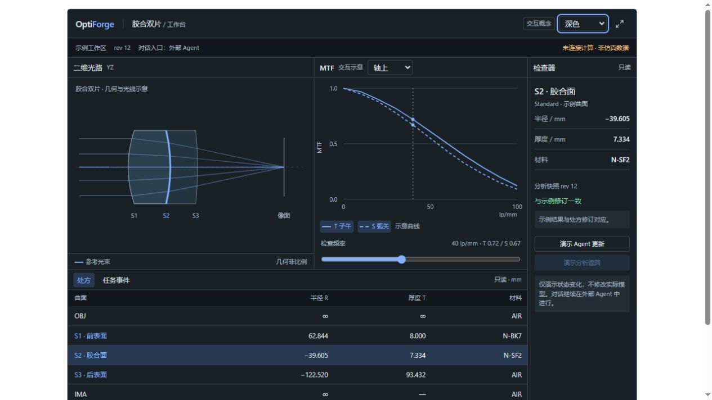

# OptiForge UI 参考与交互设计方向

调研日期：2026-10-27。用户选择：浅深双主题，先评审布局。自然语言对话继续在外部 Agent 应用中进行。

本文件保留首轮研究。用户反馈首轮信息密度过大后，当前方案调整为主页只显示 2D 光路与表面属性、分析移至二级页；新版实现和审核记录见 [UI_REVIEW_V2.md](UI_REVIEW_V2.md)。下文“推荐方向”属于首轮方案，不作为当前待审核布局。

## 推荐方向

以工程工作台为主体：项目和镜组树在左，光路占主要空间，选中对象的属性在右，处方与像质分析以可调整的面板组织。提供“光路优先”和“分析并排”两个默认工作区，两者共享同一套选择、模型版本和结果状态。避免在顶端用大量指标卡占用光路与图表空间。

本轮交付本地交互预览，只验证布局、主题、联动和反馈。处方数字参考仓库 README 的胶合双片样例；光路和分析曲线均为示意，事件为人工触发的模拟事件，不执行追迹、建模或优化，不构成真实像质结果。没有安装或集成下列新增组件依赖。

## 实际查看的工作台与范例

### Rerun Viewer：多视图与配置分离

- 源码：https://github.com/rerun-io/rerun
- 在线查看器：https://rerun.io/viewer
- Blueprint 概念：https://rerun.io/docs/concepts/blueprint
- 许可：仓库提供 MIT 与 Apache-2.0，最终采用具体代码时按对应路径核对。
- 本轮观察：浏览器中实际查看了 Viewer 的来源列表、命令入口和主要视区；Blueprint 文档确认布局、面板展开和视图配置与记录数据分离。
- 借鉴：把用户的工作区布局独立保存；同一模型的数据切换不必重置布局。将三维、二维、图表、时间或修订关联在同一个上下文中。
- 采用方式：参考信息组织，不将 Rust/WASM Viewer 整体嵌入第一阶段，也不把其全部交互宣称为已逐项实测。

### Dockview：可停靠面板

- 源码：https://github.com/dockview/dockview
- 示例索引：https://dockview.dev/examples/
- 实测社区示例：https://dockview.dev/templates/dockview/basic/react/index.html
- 功能与许可：https://dockview.dev/docs/overview/licence
- 社区核心许可：https://github.com/dockview/dockview/blob/master/packages/dockview/LICENCE.md
- 许可：社区核心 MIT；企业包另有商业许可，不能把所有官网演示能力统称为 MIT。
- 本轮观察：实际切换基础示例标签；官方文档核对拖拽分栏、停靠、最大化、浮动、保存恢复布局均有社区支持。
- 借鉴：处方、光路、MTF、波前等面板可以调整比例、切换标签、最大化，再恢复工作区。
- 限制：自动隐藏、布局历史、部分高级键盘停靠属于企业功能。第一阶段不依赖这些扩展。
- 采用方式：优先评估 `dockview-react` 社区包并锁定版本。交互预览只自行演示布局切换和尺寸调整，未集成 Dockview，不代表拖拽停靠已实现。

### Kitware Glance：科学视口与对象属性

- 源码：https://github.com/Kitware/glance
- 在线示例：https://kitware.github.io/glance/app/
- 许可：BSD-3-Clause，附加数据和依赖另行核对。
- 本轮观察：在浏览器加载公开的 `202-t + Edges` 示例，查看数据对象、Representation、Colors 面板和三维视口的组织方式。
- 借鉴：图形为主、显示控制靠近视口、对象参数就近展开，切换对象时保留相机状态。
- 采用方式：交互参考，不因参考这个应用就引入 VTK.js；第一阶段二维光路优先。

## 设计系统与模块级参考

### Penpot：画布、层级与属性的联动

- 源码：https://github.com/penpot/penpot
- 官方介绍：https://penpot.app
- 许可：MPL-2.0。
- 证据：核对仓库与 README 的开放标准、可自部署和属性检查方向；未在本轮登录设计编辑器或复制其代码。
- 借鉴：点击镜片、树节点或处方行时使用同一 selection；Inspector 显示同一对象，轻度高亮相关几何。
- 采用方式：参考交互模式并自行实现，不直接移植 Penpot 编辑器。

### shadcn/ui 与 Radix Primitives：组件与可访问性

- 源码：https://github.com/shadcn-ui/ui 、https://github.com/radix-ui/primitives
- 可查看示例：https://ui.shadcn.com/examples/dashboard 、https://ui.shadcn.com/examples/tasks
- 键盘与焦点参考：https://www.radix-ui.com/primitives/docs/overview/accessibility
- 许可：MIT。
- 本轮观察：实际查看 shadcn 示例的表格、菜单、状态、主题入口；核对 Radix 的焦点管理和键盘规范。
- 借鉴：字体、间距、菜单、对话框、Tabs、Tooltip、快捷命令和一致的 focus 样式。
- 采用方式：按需采用开源组件并建立 OptiForge 自己的 token，不将营销 Dashboard 的收入卡片和大面积留白照搬到工程工作台。

### TanStack Table：高密度处方表

- 源码：https://github.com/TanStack/table
- 行选择文档：https://tanstack.com/table/v8/docs/guide/row-selection
- 许可：MIT。
- 证据：核对官方文档的 controlled row selection；未在本轮执行大数据性能测试。
- 借鉴：受控选择、固定列头、列宽、数值对齐与可选列。光学面顺序具有物理含义，不能直接套用普通表格的任意排序或拖拽重排。
- 采用方式：处方数据量需要时使用 headless 表格；第一阶段处方以查看与定位为主，不能让视觉交互绕过 Agent 的模型修改与确认门禁。

### Apache ECharts：多曲线交互

- 源码：https://github.com/apache/echarts
- 官方示例：https://echarts.apache.org/examples/en/index.html
- 事件与行为：https://echarts.apache.org/handbook/en/concepts/event/
- 许可：Apache-2.0。
- 借鉴：悬停游标、图例开关、缩放，以及视场选择联动。T/S 用实线和虚线区分，色彩只表达稳定的波长或视场身份。
- 采用方式：生产分析图候选依赖。图表必须注明单位、采样、波长、视场、参考方式、引擎和模型修订。点列斑图保持诊断性质。

### Motion：有原因的过渡

- 源码：https://github.com/motiondivision/motion
- 减少动态效果：https://motion.dev/docs/react-use-reduced-motion
- 许可：开源 Motion 为 MIT；Motion+ 的付费素材和示例不自动包含在内。
- 借鉴：面板展开与布局切换、选择反馈和新数据到达的短过渡。
- 采用方式：先使用 CSS 原生过渡，复杂布局确有需要再引入开源 Motion。尊重 `prefers-reduced-motion`，不添加循环光束、闪烁数字或持续装饰动画。

## 各模块应如何动态响应

1. **工作区布局：**拖动边界立即调整光路与表格空间；在光路优先与分析并排之间切换；保存布局和恢复默认。布局变化不触发光学计算。
2. **对象选择：**树、镜片和处方行选中同一个对象；Inspector 同步更新；只对相关曲面高亮，不让全屏闪烁。
3. **显示条件：**波长、视场和图例开关只筛选已存在的数据；没有该条件的结果时明确提示需要计算，不能画出推测曲线。
4. **Agent 参数更新：**显示变更字段与模型修订；旧分析立即标记为过期，仍允许查看其所属历史版本。
5. **分析返回：**仅在返回结果的修订号与请求匹配时标为当前；较旧任务迟到时保留为历史结果，不覆盖最新数据。
6. **任务：**显示排队、运行、完成、失败与真实耗时。缺少可测进度时只显示运行状态；取消操作必须等待后端确认，不将发送取消请求直接显示成已取消。
7. **连接：**断连后保留最后快照并标明时间、离线状态；重连后按版本重新同步，历史快照不能冒充实时结果。
8. **主题：**浅色和深色共用结构与状态表达，图形、文字、表格及 Tooltip 同步切换；选中、告警和曲线不能只用色相区分。

## UI 子阶段验收

- [ ] 用户先评审两种布局，并确定默认模式、信息密度和面板优先级。
- [ ] 双主题检查光路、网格、数值与状态的对比度。
- [ ] 选择联动、视场切换、分栏调整、旧结果过期及新结果返回均有可操作演示。
- [ ] 1366×768 与 1920×1080 下主要工程区域可用；窄窗口用标签和折叠保持主要任务可达。
- [ ] 键盘、焦点、减少动态效果和主题切换通过检查。
- [ ] 用户认可交互方向后，在阶段一实现中用真实服务状态替换全部示意数据。

本轮 UI 参考与交互预览不等于阶段一功能交付；只有真实 Agent、共享工程服务与 UI 的闭环通过后，阶段一才能进入整体验收。

## 本轮预览检查记录

- 两个布局支持跟随系统、浅色、深色；主题共享，其他演示操作在各自布局中独立保留。生产工作台将共享同一项目状态。
- 实际操作验证：树/场景/处方选择联动、主题切换、视场切换、图例开关、频率键盘调整、主视区最大化与恢复、分栏方向键调整。
- 模拟事件验证：模型修订增加后保留旧曲线并标记过期；模拟任务返回后更新分析修订。旧曲线不会在返回前随新参数悄悄变化。
- 用浏览器的实际 iframe 检查 320、700、736、1024、1366、1920px 宽度；在两种布局及窄窗过期状态中检查主要元素溢出，修复处方末行、移动端分栏和长提示遮挡。1366×768 的完整视口高度验收仍属于生产阶段，预览本身可以纵向滚动。
- 脚本语法检查通过；桌面预览控制台未发现 error/warn。减少动画使用 CSS 媒体查询，未单独切换操作系统设置做实测。
- 完整拖拽停靠、布局保存、真实后端断连/重连、计算取消及生产数据性能尚未实现。
- 本轮没有修改 MCP 业务或启动 Zemax 仿真，没有安装新依赖；稳定工作区保持原提交。

深色并排布局的实际浏览器截图（可见区域）：

