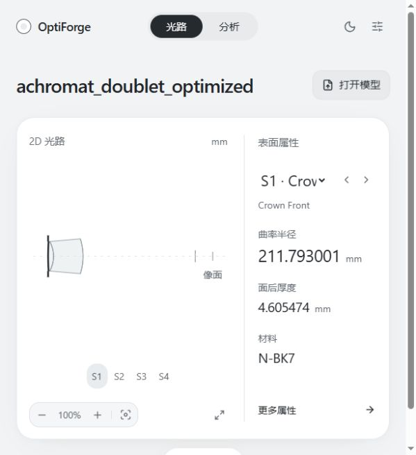

# 阶段一 · 第一批：真实模型只读显示

状态：R1/R2 修复及开发验证完成，待规划聊天复审与用户验收。日期：2026-10-28。

本批将获认可的 UI 接入真实 Zemax 模型，交付范围是“读取已有模型 → 二维轮廓与属性 → 手动刷新”。阶段一整体仍在进行。

## 运行

新版工作区：`C:\Users\Kernel\.codex\worktrees\optiforge-visual-workbench\mcp gemini zemax`。

在此目录打开终端：

```powershell
.\start-workbench.ps1 -Model '.\output\workbench_acceptance\source\achromat_doublet_optimized.zmx'
```

脚本构建前端后启动服务，浏览器访问 <http://127.0.0.1:8765/>。停止时在服务终端按 Ctrl+C；这会关闭此服务持有的 Zemax 会话。已有构建可加 `-SkipBuild`，端口可用 `-Port` 指定。

首次检出需在 `frontend` 运行 `npm ci`，并准备原项目的 Python 环境、Zemax 安装及有效 API 许可。服务使用 Python 标准库，无新增 Python 运行依赖。本机验证环境为 Python 3.12.10、mcp 2.2.0、pythonnet 3.1.0、OpticStudio 2024 R1。

验收镜头是原工作区已有文件的本地副本，不随 Git 分发；新检出可先启动 `python -B workbench.py`，再在 UI 点“打开模型”选择已有 `.zmx/.zos`。UI 将文件复制到新版 `output/import_<name>_<id>/source/` 后读取。直接使用 `--model` 时读取的是指定路径，建议传入副本。

旧的 `4173` 入口是纯前端构建预览。演示界面仍可用 `http://127.0.0.1:8765/?preview` 查看；真实接入请使用不带 `preview` 的地址。

## 外部 Agent 连接

自然语言对话继续在外部 Agent。选择试用新版时，让其 stdio MCP 入口指向本工作区的 `server.py`，并增加环境变量 `OPTIFORGE_SERVICE_URL=http://127.0.0.1:8765`。先启动工程服务，再启动 MCP。没有改动用户现有客户端配置。

常见客户端的配置示例（各客户端实际字段以自身配置规范为准）：

```json
{
  "mcpServers": {
    "optiforge-workbench": {
      "command": "C:\\Users\\Kernel\\AppData\\Local\\Programs\\Python\\Python312\\python.exe",
      "args": ["-B", "C:\\Users\\Kernel\\.codex\\worktrees\\optiforge-visual-workbench\\mcp gemini zemax\\server.py"],
      "env": {"OPTIFORGE_SERVICE_URL": "http://127.0.0.1:8765"}
    }
  }
}
```

该环境变量只用于 MCP 子进程，不能设置在工程服务启动进程中。代理从本工作区的 `output/workbench_service/service.json` 读取本地连接凭据；无需在客户端写入 token。服务不可用时明确报错，不会另开一份模型作为回退。

原工具名称和参数保留，新增只读工具 `zemax_get_workbench_snapshot`。所有请求由工程服务的同一个引擎线程串行执行。此批验证了真实 MCP stdio 协议与 HTTP 共享同一模型，尚未逐个验证所有 Agent 客户端。

## 本批支持范围

- 任意数量表面的原生索引，物面和像面；半径、面后厚度、材料、半口径、圆锥系数、面型、光阑、半径与厚度求解。
- 原生长度单位、当前多配置序号与总数、孔径设置、视场和波长。无穷大在 UI 显示为 `∞`。
- 同轴、向前传播、默认圆口径的序列 Standard 球面、平面和圆锥面二维截面；横纵同尺度，像面位置累计真实处方厚度。放大时围绕选中的曲面，适应视图恢复完整系统。
- 表面选择、前后切换、更多属性、手动刷新、刷新浏览器恢复服务当前模型、深浅主题及动效设置。
- 打开本地文件、文件类型与大小校验、加载失败提示；导入和对应快照在同一队列项内执行。

遇到 CoordinateBreak、折叠反射、其他面型、局部倾斜/偏心/坐标返回、自定义孔径、负内部厚度、无法解释的口径或相交镜片时，属性仍可查看，二维轮廓明确提示不支持。当前不读取特殊面型的专属系数，也不显示机械外径、倒角和镜筒；轮廓不构成制造图纸或 DFM 验收。

相邻有效光学边界在共同有效半口径内先检查净空，再构造玻璃填充。检查包含中心、口径端点和圆锥面间距的内部驻点，不依赖绘图采样；长度容差为 `1e-10 * max(共同半口径, abs(中心间距))`。负空气净空或不大于容差的玻璃厚度会被拒绝，并清空全部轮廓，保留原始属性。两侧为空气的 Standard 虚拟参考面/光阑保留显示，净空检查跨过这些面并累计间距；合法共享胶合界面及同形零空气接触可显示。这是支持范围内的截面检查，不检查机械外径处的制造净空。

UI 当前只读，手动刷新后才取得 Agent 操作的新状态。页面不绘制样例光线；分析页仅显示待接入状态。只读能力声明指本批 UI，不代表现有 MCP 工具被删除。

## 已完成验证

- R1/R2 修复后，工作台离线回归 31 项、原有阶段二及阶段三各 33 项全部通过，共 97 项。工作台覆盖圆锥面几何、无穷值、曲面交叉及不支持情况、原单位、快照修订号、同线程串行执行、原子导入、传输参数校验、同源与 token 校验、静态路径边界、代理签名和不可用反馈。首次接入时修正过阶段二测试夹具缺少 MFE 行索引与 `GetOperandAt` 的模拟，未修改对应生产工具。
- R1 新增 4 项测试：嵌套参数的严格 JSON 编码、非法参数与 NaN 拒绝、有限值校验与提案门禁、实际 stdio MCP 参数解析和模拟 HTTP 引擎转发；同一连接下有限物距与正负无穷远物距均成功。另在原有测试中补充服务断连的错误分类。服务端业务错误保持原样，所有写入相关测试均未访问真实模型。
- R2 新增 6 项测试：原审查样例的边缘碰撞与单位缩放、正常空气隙与不同半口径、绘图采样间的内部驻点碰撞、胶合及同形零空气接触、虚拟光阑、零玻璃厚度。失败时原始处方不变且轮廓清空。
- 首次接入时生产前端构建通过；浏览器实测物面/像面选择、无穷大、系统详情、深浅主题、缩放适应、文件选择导入、刷新恢复，320px 宽度无横向溢出。服务停止后刷新会清除旧模型并显示断连提示。本轮未修改前端，未重复构建或浏览器验收。
- 真实 Zemax 读取 `achromat_doublet_optimized.zmx`：6 个表面（含物面/像面）、mm 单位。原生基础属性、视场、波长和系统设置逐项相等；重复读取修订号稳定，全部轮廓点符合处方 sag 与面后厚度。
- 使用 MCP 客户端实际启动 `server.py`，调用快照和系统数据工具、读取提案资源；与服务模型一致，提案确认状态仍关闭。
- 原文件和副本 SHA-256 均为 `074036cc30e712bf748c3036cb0ef2dd261d4fa2ef58a923f8f13428f7730dd6`，验收读取未改变文件内容。

更新后服务的原生只读复验于 `2026-10-28T02:19:22.919439+00:00` 通过 10 项检查，模型修订号为 `bb81b0b35d0bdc7b`；未执行真实建模、优化、追迹或像质分析。R1/R2 实现依据、测试证据及复审边界见 [修复交接记录](WORKBENCH_R1_R2_HANDOFF.md)。

复现命令：

```powershell
python -B tests/test_workbench.py
python -B tests/regression_stage_two.py
python -B tests/regression_stage_three.py
python -B tests/verify_workbench_native.py --source 'D:\mcp gemini zemax\output\achromat_doublet_optimized.zmx'
```

前三个是离线测试。最后一个要求服务已加载验收副本，只进行读取，不建模、不优化、不追迹、不运行像质分析。记录存于 `output/workbench_acceptance/reports/`，包含快照、原生验收 JSON 与 MCP 日志，不含服务 token。

## 用户验收与后续

先由规划聊天复审本轮 R1/R2 修复，再由用户在真实入口检查当前模型的曲面选择、半径/厚度/材料、更多属性、缩放与文件打开。开发验证通过不代表规划复审或用户验收通过。用户确认本批通过后，再依据后续具体计划接入第二批“Agent 操作自动同步与断连恢复”，随后接入真实光线和分析。

全部成果仅保存在本地开发分支 `codex/visual-workbench-stage-one`。稳定原版 `D:\mcp gemini zemax` 和基线标签保持可用；回退时停止新版服务，使用原工作区和原 MCP 配置。未设置 `OPTIFORGE_SERVICE_URL` 的原入口仍按既有方式运行。

不执行 push、远程 PR 或部署；将来上传按用户指令使用 SSH。

## 页面实测截图


